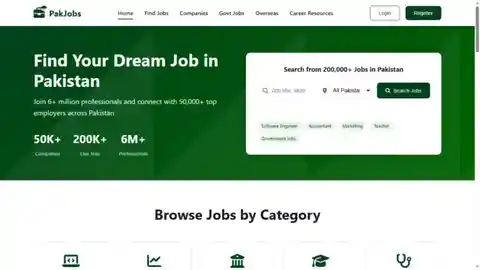

# 💼 PakJobs – Job Portal Website

A responsive job portal frontend designed to help users explore job opportunities across Pakistan through a clear layout and user-friendly interface.

## 🌐 Live Demo

[Open the deployed website](https://job-portal-website1-nine.vercel.app)

## ✨ Project Highlights

- Job portal landing page
- Job-search and recruitment interface
- Search form with job title and location fields
- Job categories and career resources navigation
- Login and registration entry points
- Responsive page layout
- Interactive elements implemented with JavaScript

## 🧰 Tech Stack

- HTML5
- CSS3
- JavaScript

## 📸 Website Preview



## 📁 Project Files

- `index.html` — main page structure
- `style.css` — page styling and responsive presentation
- `scripts.js` — interactive behavior
- `screenshots/pakjobs-home.webp` — homepage screenshot

## ▶️ Run Locally

1. Clone the repository:

   ```bash
   git clone https://github.com/syedanoorfatima/Job-Portal-Website1.git
   ```

2. Open the project folder.
3. Open `index.html` in your browser, or use a local development server.

## 👩‍💻 Author

**Syeda Noor Fatima**

[GitHub](https://github.com/syedanoorfatima) · [LinkedIn](https://www.linkedin.com/in/syeda-noor-fatima-webdeveloper)

---

*Created as a web-development learning and portfolio project.*
